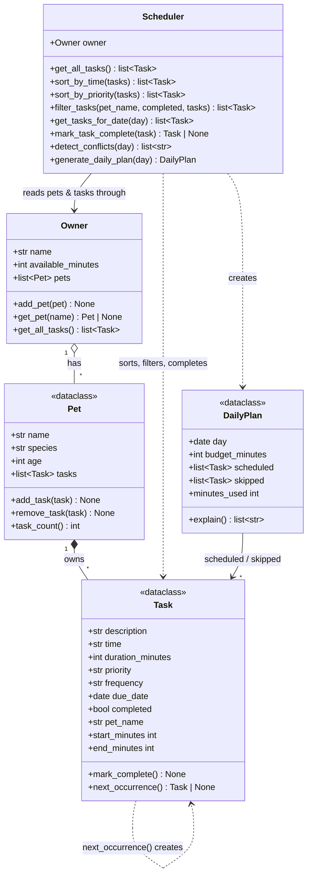

# 🐾 PawPal+

PawPal+ is a pet care planner built with Python and Streamlit. It helps a busy owner keep track of walks, meals, medications, and appointments for several pets. It sorts the day's tasks, warns about overlapping tasks, repeats daily and weekly tasks automatically, and builds a priority-first plan that fits the time the owner has.

## ✨ Features

- **Multiple pets per owner.** Add pets with species and age. Duplicate names are rejected.
- **Rich tasks.** Each task has a time, duration, priority (high, medium, low), frequency (once, daily, weekly), and due date. Bad input such as `"25:00"` is rejected when the task is created.
- **Sorting by time.** The schedule is always shown in chronological order, no matter what order tasks were added in. Tomorrow's tasks come after today's.
- **Filtering.** View one pet's tasks, or only to-do or done tasks.
- **Daily and weekly recurrence.** Marking a recurring task done automatically schedules the next one, for tomorrow or next week.
- **Conflict warnings.** Overlapping time windows are flagged, whether for the same pet or across pets. They show as warnings, not errors.
- **Smart daily plan.** High-priority tasks are picked first until the owner's available minutes run out. Every task is listed as scheduled or skipped, with the reason.

## 🗂️ Project structure

| File | Purpose |
|------|---------|
| `pawpal_system.py` | Logic layer: `Task`, `Pet`, `Owner`, `Scheduler`, `DailyPlan` |
| `app.py` | Streamlit UI, which only calls methods from `pawpal_system.py` |
| `main.py` | CLI demo that exercises every scheduler feature |
| `tests/test_pawpal.py` | pytest suite (31 tests) |
| `diagrams/uml_final.mmd` | Final Mermaid class diagram (`uml.mmd` is the same file; `uml_draft.mmd` is the Phase 1 draft) |
| `reflection.md` | Design and AI-collaboration reflection |

## 🚀 Getting started

```bash
python -m venv .venv
source .venv/bin/activate  # Windows: .venv\Scripts\activate
pip install -r requirements.txt

python main.py           # CLI demo
streamlit run app.py     # web app
python -m pytest         # tests
```

## 📐 Architecture



The `Scheduler` doesn't store any tasks itself. It always reads them through `Owner → Pet → Task`, so the UI, the CLI, and the tests all work from a single source of truth.

## 🖥️ Sample Output

Output of `python main.py`. Tasks are added out of order on purpose, two pairs overlap, and the owner has 60 minutes:

```
Today's Schedule for Jordan (sorted by time)
--------------------------------------------
  [ ] 07:30  Mochi: Morning walk (30 min, high, daily)
  [ ] 07:45  Luna: Breakfast (10 min, high, daily)
  [ ] 12:00  Luna: Flea medication (5 min, high, weekly)
  [ ] 15:00  Mochi: Puzzle toy (20 min, low, once)
  [ ] 18:00  Mochi: Evening walk (30 min, medium, daily)
  [ ] 18:15  Luna: Brushing (15 min, low, weekly)

Conflict check
--------------
  ⚠ Conflict: 'Morning walk' (07:30–08:00) overlaps 'Breakfast' (07:45–07:55), Mochi and Luna.
  ⚠ Conflict: 'Evening walk' (18:00–18:30) overlaps 'Brushing' (18:15–18:30), Mochi and Luna.

Only Mochi's tasks (filtered, in the order they were added)
-----------------------------------------------------------
  [ ] 18:00  Mochi: Evening walk (30 min, medium, daily)
  [ ] 07:30  Mochi: Morning walk (30 min, high, daily)
  [ ] 15:00  Mochi: Puzzle toy (20 min, low, once)

Marked 'Morning walk' complete → next one added for 2026-11-11

Still to do (incomplete, sorted)
--------------------------------
  [ ] 07:45  Luna: Breakfast (10 min, high, daily)
  [ ] 12:00  Luna: Flea medication (5 min, high, weekly)
  [ ] 15:00  Mochi: Puzzle toy (20 min, low, once)
  [ ] 18:00  Mochi: Evening walk (30 min, medium, daily)
  [ ] 18:15  Luna: Brushing (15 min, low, weekly)
  [ ] 2026-11-11 07:30  Mochi: Morning walk (30 min, high, daily)

Today's plan (priority first, within time budget)
-------------------------------------------------
  Planned 4 task(s) using 60 of 60 available minutes.
    ✔ 07:45 Luna: Breakfast — high priority
    ✔ 12:00 Luna: Flea medication — high priority
    ✔ 18:00 Mochi: Evening walk — medium priority
    ✔ 18:15 Luna: Brushing — low priority
    ✘ Mochi: Puzzle toy skipped — needs 20 min, not enough time left after higher-priority tasks
```

## 📐 Smarter Scheduling

All scheduling logic lives in `Scheduler` in `pawpal_system.py`.

| Feature | Method(s) | How it works |
|---------|-----------|--------------|
| Sorting by time | `Scheduler.sort_by_time()` | `sorted()` with a lambda key of `(due_date, minutes after midnight)`, so `"07:30"` comes before `"18:00"` and tomorrow's tasks come after today's. Times are normalized to zero-padded `HH:MM` when a `Task` is created. |
| Sorting by priority | `Scheduler.sort_by_priority()` | Orders high → medium → low, then by time. Used by the daily planner. |
| Filtering | `Scheduler.filter_tasks(pet_name=, completed=)` | Keeps tasks matching a pet name (case-insensitive) and/or completion status. Passing `None` means "don't filter on this." `get_tasks_for_date()` filters by due date. |
| Recurring tasks | `Scheduler.mark_task_complete()`, `Task.next_occurrence()` | Completing a `daily` or `weekly` task creates a fresh copy due `today + timedelta(days=1)` or `+ timedelta(weeks=1)` and adds it to the same pet. `once` tasks just get marked done. |
| Conflict detection | `Scheduler.detect_conflicts()` | Sorts the day's unfinished tasks by start time and flags any pair whose `[start, start + duration)` windows overlap, for the same pet or different pets. It returns warning strings instead of raising, so the app keeps running. |
| Daily plan within a time budget | `Scheduler.generate_daily_plan()` → `DailyPlan` | Greedy: takes unfinished tasks for the day in priority order and keeps each one that still fits in `Owner.available_minutes`. `DailyPlan.explain()` says why each task was kept or skipped. |

## 🧪 Testing PawPal+

Run the suite from the project root:

```bash
python -m pytest
```

`tests/test_pawpal.py` has 31 tests covering:

- **Basics.** `mark_complete()` flips the status, adding and removing tasks changes a pet's task count, `Owner` collects tasks across all pets and rejects duplicate pet names.
- **Validation.** Bad times (`"25:00"`, `"noon"`), unknown priorities or frequencies, and non-positive durations raise `ValueError`. `"7:05"` is normalized to `"07:05"`.
- **Sorting.** Tasks come back in chronological order even when added out of order. Tomorrow's tasks sort after today's. Equal priorities are tie-broken by time. An empty schedule returns an empty list.
- **Filtering.** By pet name (case-insensitive), by completed or not completed, and an unknown pet returns nothing.
- **Recurrence.** Completing a daily task adds a new, incomplete copy due tomorrow. A weekly task's copy is due in 7 days. A one-time task doesn't recur. Completing a task twice doesn't create duplicates. The new copy is independent of the original.
- **Conflict detection.** Identical start times are flagged, overlapping durations for the same pet are flagged, back-to-back tasks (08:00–08:30 then 08:30) are *not* flagged, completed and other-day tasks are ignored, and one long task can conflict with several others.
- **Daily plan.** High-priority tasks win when time is short, the plan never exceeds the owner's budget, skipped tasks are explained, and completed tasks or empty schedules give an empty plan.

Sample test output:

```
============================= test session starts ==============================
platform darwin -- Python 3.13.9, pytest-9.1.1, pluggy-1.5.0
rootdir: /Users/alyhegazy/Desktop/CodePath /ai110-module2show-pawpal-starter
plugins: anyio-4.15.1
collected 31 items

tests/test_pawpal.py ...............................                     [100%]

============================== 31 passed in 0.02s ==============================
```

**Confidence level: ★★★★☆ (4/5).** Every scheduling rule has a test, including the edge cases I could think of (empty schedules, exact-time ties, back-to-back tasks). I'm holding back one star because the Streamlit UI is only checked by hand, and the planner's greedy choice isn't compared against an optimal plan.

## 📸 Demo Walkthrough

Run `streamlit run app.py`, then:

1. **Set up the owner.** In the sidebar, enter your name and how many minutes you have for pet care today (for example, 60).
2. **Add pets.** Use the sidebar form to add *Mochi* (dog, 3) and *Luna* (cat, 5). Each pet then appears in the sidebar with its task count. Adding a second "mochi" shows an error, because names must be unique.
3. **Schedule tasks.** Open **➕ Schedule a task**. Pick a pet and enter a name, date, time, duration, priority, and repeat setting. For example: Mochi, *Morning walk*, 07:30, 30 min, high, daily. Then Luna, *Breakfast*, 07:45, 10 min, high, daily.
4. **View the sorted schedule.** The **📅 Schedule** table always lists the chosen day's tasks by time, whatever order you entered them in. The **Pet** and **Show** dropdowns filter it with `Scheduler.filter_tasks()`.
5. **See conflict warnings.** Because the walk (07:30–08:00) overlaps breakfast (07:45–07:55), a yellow `st.warning` box lists the clashing tasks, their time ranges, and which pets they belong to. With no overlaps, a green "No conflicts" message appears instead.
6. **Complete a recurring task.** Choose *07:30 · Mochi: Morning walk* in the "Mark a task done" box and click **✔ Done**. The row turns ✅, and a toast confirms that the next walk was added for tomorrow. Change the **Day** picker to tomorrow to see it.
7. **Generate the smart plan.** Click **Generate plan**. A green summary shows how many minutes are used out of the budget, a table lists the chosen tasks in time order, and each task that didn't fit gets a warning explaining it was skipped for higher-priority work. **Why this plan?** shows the full reasoning.

**Key Scheduler behaviors shown:** sorting by time (`sort_by_time`), filtering by pet and status (`filter_tasks`), overlap conflict warnings (`detect_conflicts`), daily and weekly recurrence (`mark_task_complete`), and the priority-first plan within a time budget (`generate_daily_plan`).

CLI output of the same features (`python main.py`):

```
Today's Schedule for Jordan (sorted by time)
--------------------------------------------
  [ ] 07:30  Mochi: Morning walk (30 min, high, daily)
  [ ] 07:45  Luna: Breakfast (10 min, high, daily)
  [ ] 12:00  Luna: Flea medication (5 min, high, weekly)
  [ ] 15:00  Mochi: Puzzle toy (20 min, low, once)
  [ ] 18:00  Mochi: Evening walk (30 min, medium, daily)
  [ ] 18:15  Luna: Brushing (15 min, low, weekly)

Conflict check
--------------
  ⚠ Conflict: 'Morning walk' (07:30–08:00) overlaps 'Breakfast' (07:45–07:55), Mochi and Luna.
  ⚠ Conflict: 'Evening walk' (18:00–18:30) overlaps 'Brushing' (18:15–18:30), Mochi and Luna.

Only Mochi's tasks (filtered, in the order they were added)
-----------------------------------------------------------
  [ ] 18:00  Mochi: Evening walk (30 min, medium, daily)
  [ ] 07:30  Mochi: Morning walk (30 min, high, daily)
  [ ] 15:00  Mochi: Puzzle toy (20 min, low, once)

Marked 'Morning walk' complete → next one added for 2026-11-11

Still to do (incomplete, sorted)
--------------------------------
  [ ] 07:45  Luna: Breakfast (10 min, high, daily)
  [ ] 12:00  Luna: Flea medication (5 min, high, weekly)
  [ ] 15:00  Mochi: Puzzle toy (20 min, low, once)
  [ ] 18:00  Mochi: Evening walk (30 min, medium, daily)
  [ ] 18:15  Luna: Brushing (15 min, low, weekly)
  [ ] 2026-11-11 07:30  Mochi: Morning walk (30 min, high, daily)

Today's plan (priority first, within time budget)
-------------------------------------------------
  Planned 4 task(s) using 60 of 60 available minutes.
    ✔ 07:45 Luna: Breakfast — high priority
    ✔ 12:00 Luna: Flea medication — high priority
    ✔ 18:00 Mochi: Evening walk — medium priority
    ✔ 18:15 Luna: Brushing — low priority
    ✘ Mochi: Puzzle toy skipped — needs 20 min, not enough time left after higher-priority tasks
```
